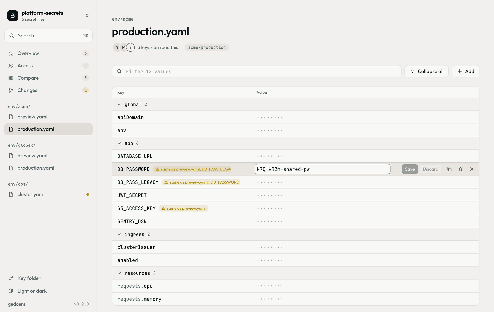
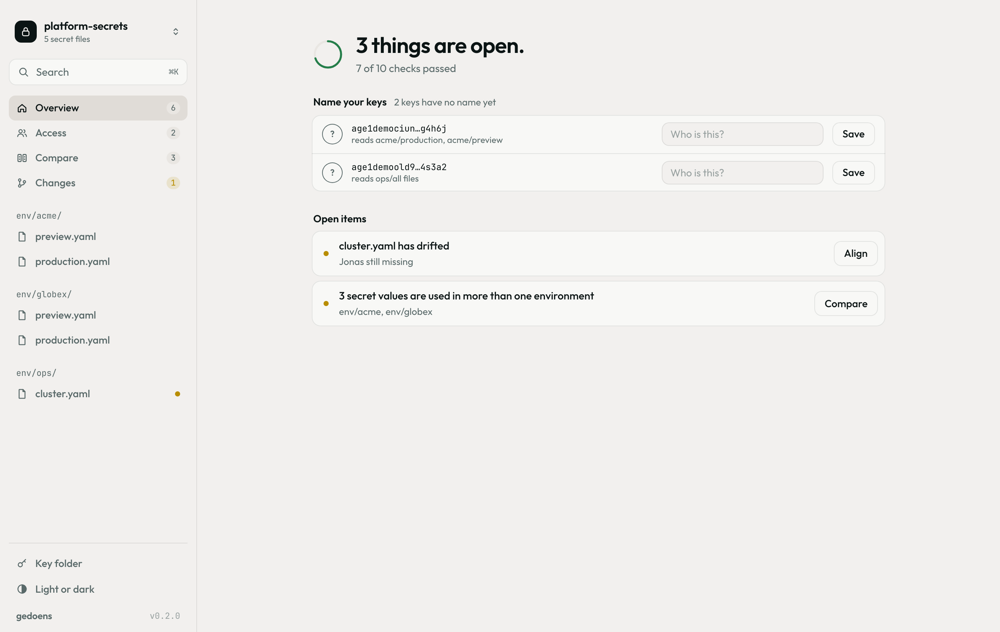
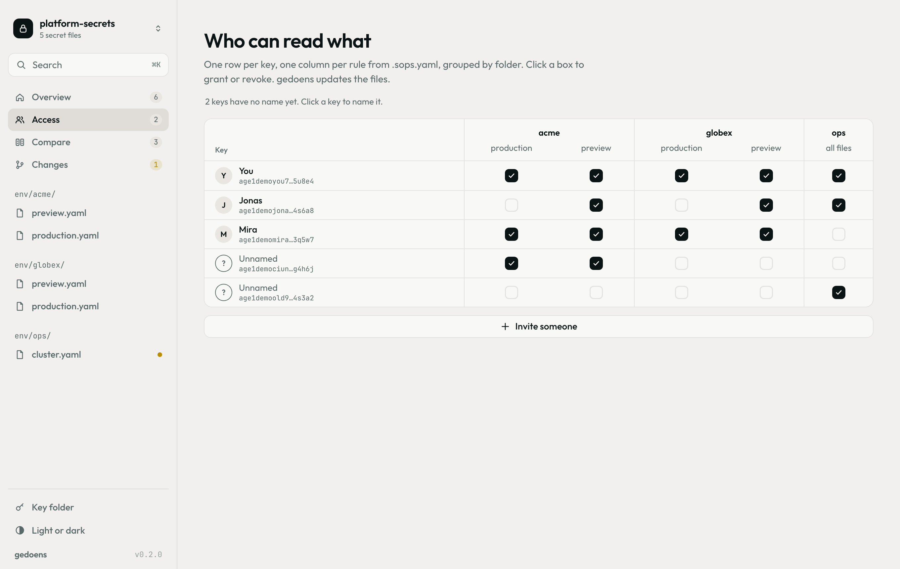
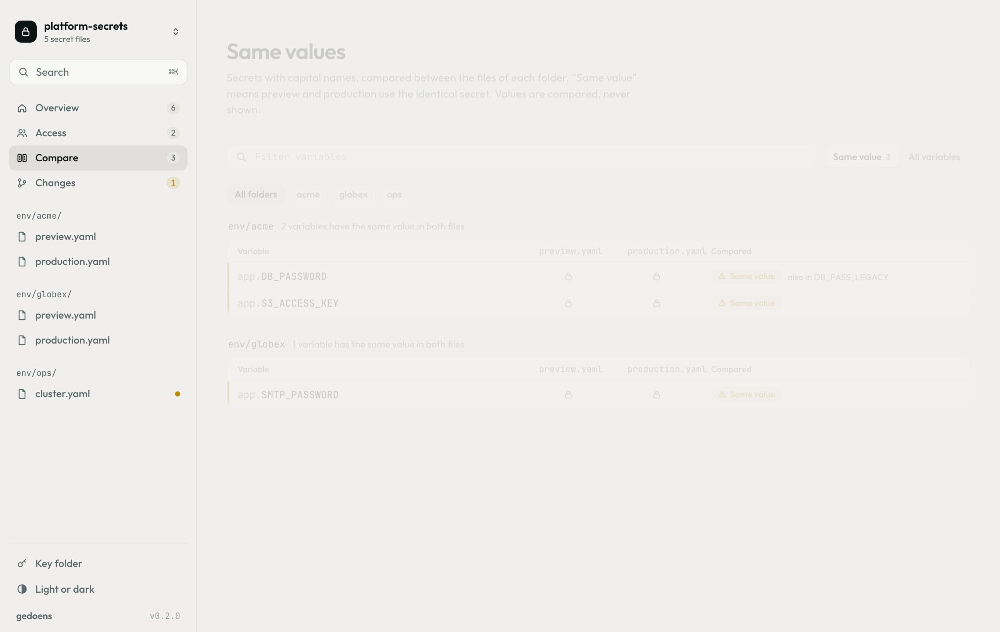
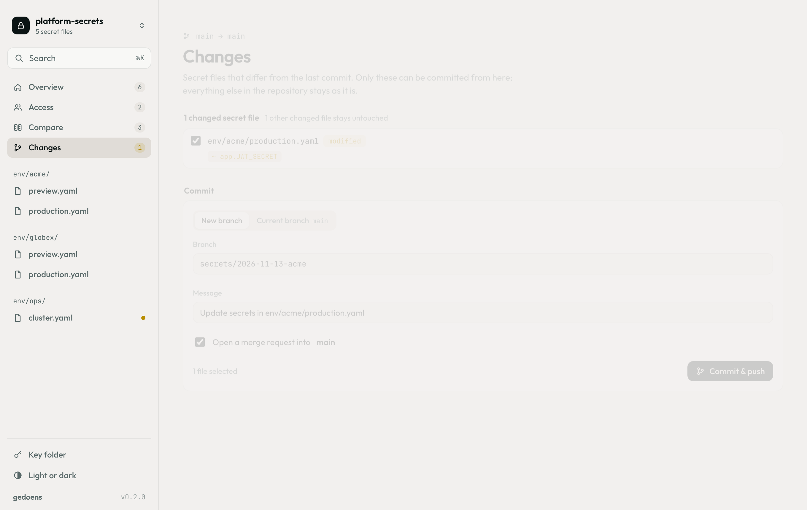

<div align="center">


# gedoens

**A small secrets manager for teams that use SOPS.**

Read and change secrets, decide who may read what, spot passwords shared between environments,<br>
and ship the change as a merge request. Git does the syncing, your age keys do the locking.

<br>

[](https://github.com/philipempl/gedoens/actions/workflows/ci.yml)
[](https://github.com/philipempl/gedoens/releases/latest)
[](https://github.com/philipempl/gedoens/releases)
[](https://github.com/philipempl/gedoens/stargazers)
[](https://github.com/philipempl/gedoens/issues)
[](https://getsops.io)

<br>

[](https://github.com/philipempl/gedoens/releases/latest/download/gedoens-macos.dmg)
[](https://github.com/philipempl/gedoens/releases/latest/download/gedoens-windows-setup.exe)
[](https://github.com/philipempl/gedoens/releases/latest/download/gedoens-linux.AppImage)

No server, no account, no telemetry. Everything runs on your machine.

</div>

<br>

<picture>
  <source media="(prefers-color-scheme: dark)" srcset="assets/screenshots/file-dark.png">
  
</picture>

---

## What it does

|  |  |
|---|---|
| **Files** | Every SOPS file in the folder (YAML, JSON, ENV, INI) as one table, grouped by section, with a filter. Values stay as dots until you click one. Edit in place; nothing is written until you press **Save** or <kbd>Enter</kbd>, and every save can be undone. |
| **Access** | One table answers *who may read what*: keys down, rules from `.sops.yaml` across, grouped by folder. Tick a box to grant. Revoking updates the files and rotates their data keys in one step. |
| **Names** | Every key gets a name, stored as a comment next to it in `.sops.yaml` (`- age1…  # Anna`). Unnamed keys are listed first on the overview, with a field to name them right there. |
| **Same values** | Secrets with capital names (`DB_PASSWORD`, `API_KEY`) are compared between the files of each folder. When preview and production share a password, it says so, next to the key and on the overview. Values are compared in the backend and never shown. |
| **Changes** | The secret files that differ from the last commit, down to which values were added, changed or removed. Commit them on a new branch, push, and open a GitLab merge request in one step. Other files in the repository are never touched. |
| **Drift and merging** | A file whose recipients differ from its rule shows up with one button to fix it. After a pull, edits to the same file are merged value by value; you are asked only where both sides changed the same value. |
| **Updates** | New releases download in the background. A note in the sidebar offers a restart, and that is all. |

<table>
  <tr>
    <td width="50%"><picture><source media="(prefers-color-scheme: dark)" srcset="assets/screenshots/home-dark.png"></picture></td>
    <td width="50%"><picture><source media="(prefers-color-scheme: dark)" srcset="assets/screenshots/access-dark.png"></picture></td>
  </tr>
  <tr>
    <td align="center"><sub>Overview: name your keys, fix what is open</sub></td>
    <td align="center"><sub>Access: who may read what</sub></td>
  </tr>
  <tr>
    <td width="50%"><picture><source media="(prefers-color-scheme: dark)" srcset="assets/screenshots/compare-dark.png"></picture></td>
    <td width="50%"><picture><source media="(prefers-color-scheme: dark)" srcset="assets/screenshots/changes-dark.png"></picture></td>
  </tr>
  <tr>
    <td align="center"><sub>Same values: one password, two environments</sub></td>
    <td align="center"><sub>Changes: branch, commit, merge request</sub></td>
  </tr>
</table>

<sub>Screenshots use made-up sample data.</sub>

## Install

| Platform | Download |
|---|---|
| macOS · Apple Silicon and Intel | [`gedoens-macos.dmg`](https://github.com/philipempl/gedoens/releases/latest/download/gedoens-macos.dmg) |
| Windows | [`gedoens-windows-setup.exe`](https://github.com/philipempl/gedoens/releases/latest/download/gedoens-windows-setup.exe) · [`gedoens-windows.msi`](https://github.com/philipempl/gedoens/releases/latest/download/gedoens-windows.msi) |
| Linux | [`gedoens-linux.AppImage`](https://github.com/philipempl/gedoens/releases/latest/download/gedoens-linux.AppImage) · [`gedoens-linux.deb`](https://github.com/philipempl/gedoens/releases/latest/download/gedoens-linux.deb) · [`gedoens-linux.rpm`](https://github.com/philipempl/gedoens/releases/latest/download/gedoens-linux.rpm) |

The links always point to the newest release. Older versions are on the [releases page](https://github.com/philipempl/gedoens/releases).

You also need **`sops` 3.10 or newer** and **`git`**:

```bash
brew install sops    # macOS; other systems: https://getsops.io/docs/#download
```

The macOS build is **not signed**. macOS will claim the app *is damaged and can't be opened*; it is not, that is what Gatekeeper says about any unsigned app from the internet. Clear the quarantine flag once after installing:

```bash
xattr -dr com.apple.quarantine "/Applications/gedoens.app"
```

## Your key

gedoens uses the age key you already have, wherever SOPS would find it:

1. `$SOPS_AGE_KEY` and `$SOPS_AGE_KEY_FILE`
2. `$XDG_CONFIG_HOME/sops/age/keys.txt`
3. the SOPS default for your system (`~/Library/Application Support/sops/age/keys.txt` on macOS)
4. `~/.config/sops/age/keys.txt`, where most guides put it

An app started from the Dock does not see the variables from your shell profile, so if your key lives somewhere else, pick its folder once (**Key folder** at the bottom of the sidebar). gedoens remembers it outside the repository and hands every key it found to `sops` directly.

Only when there is no key anywhere does gedoens offer to create one. It never creates a second key, and it backs up an existing `keys.txt` before writing to it.

## Merge requests without a token

**Changes** pushes with GitLab's [push options](https://docs.gitlab.com/topics/git/commit/#push-options-for-gitlab) (`-o merge_request.create`), so no API token and no `glab` are needed: Git uses the credentials it already has, and GitLab answers with the link to the new merge request. The description lists the changed variables, never their values.

A new branch starts from the branch you are on. If that branch is ahead of `main`, gedoens says so, because those commits would end up in the merge request too.

The app cannot ask for a password. If Git has no stored credentials for your remote yet, push once from the terminal so they get saved.

## Compatibility

Whoever does not use gedoens notices nothing.

- Every file stays a plain SOPS file. gedoens only writes through the official `sops` binary and adds no fields of its own.
- gedoens keeps no file of its own in your repository.
- Rules that use key groups or YAML aliases are shown but never rewritten.
- `.sops.yaml` is read with a YAML parser but edited as text: only the `age` block of the affected rule changes, everything else stays byte for byte.

## Security

- gedoens does not reimplement SOPS. It drives the official binary and passes secret values through stdin, never on the command line.
- The backend holds no plaintext between requests. The interface receives one value at a time and only when you click it.
- Comparing values for **Same values** and **Changes** happens in the backend; only paths and verdicts reach the interface.
- Copying a value happens in the backend, and the clipboard is cleared after 30 seconds.
- Updates are signed. The app installs only bundles signed with the project's key; its public half is in [`src-tauri/tauri.conf.json`](src-tauri/tauri.conf.json).

## Development

Rust stable, plus `sops` and `git` for the end-to-end tests. On Linux also `libwebkit2gtk-4.1-dev libgtk-3-dev librsvg2-dev patchelf`.

```bash
cargo test                                       # domain, application, adapters, real sops and git
cargo run -p gedoens -- path/to/repo             # run the app on a folder
cargo install tauri-cli --version "^2" --locked
cargo tauri build                                # installers in target/release/bundle/
```

`GEDOENS_SOPS` and `GEDOENS_GIT` point to other binaries. Development builds do not look for updates unless `GEDOENS_UPDATES=1` is set.

## Releases

Bump `version` in `Cargo.toml` and `src-tauri/tauri.conf.json`, then push a tag:

```bash
git tag v0.3.0
git push origin v0.3.0
```

GitHub Actions builds macOS (universal), Windows and Linux, signs the update bundles with the `TAURI_SIGNING_PRIVATE_KEY` secret, adds copies under the stable names linked above, and opens a release draft. Running apps see the update once the draft is published.

## Architecture

Domain-driven, dependencies point inwards only.

```
crates/domain          Pure rules: recipients, areas, drift, three-way merge, shared values.
                       No files, no processes. Tested without any tooling.
crates/application     Use cases and the ports they need. A value leaves this layer
                       only one at a time and only on request.
crates/infrastructure  Adapters: sops, git, file system, .sops.yaml, keys.txt.
src-tauri              The shell: one window, thin commands, the updater.
ui                     Plain HTML, CSS and JavaScript. No build step.
assets/screenshots     The pictures in this README, taken with sample data.
```

## Status

Working: files, values, access, names, drift, merging, same values, changes with merge requests, updates.

Not built yet: bundled `sops`, rotation reminders, the checklist of values to replace after removing someone, a git merge driver, app lock.

## License

Not chosen yet. The bundled fonts Outfit and JetBrains Mono are licensed under the SIL Open Font License, see [`ui/fonts`](ui/fonts).

Part of the same family of small tools as [kuebel](https://github.com/philipempl/kuebel).
